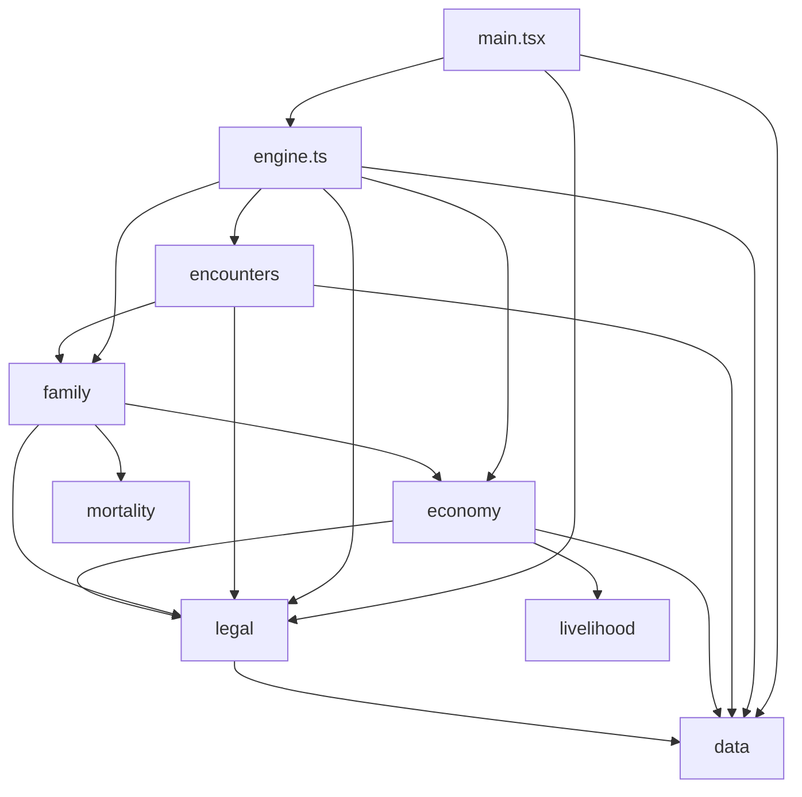

# 当前实现 · 1089c16

## 运行时依赖

图略去叶子 rng、类型导入和编排器到 mortality/livelihood 的直接边。engine、family、encounters、legal、economy、livelihood 均使用具名随机键。data 对 LegalRuleset 的反向导入仅为类型；未发现运行时循环。风险在于法律配置回调能读取整份 State，而 UI 同时读取 data、法律函数和引擎内部字段。主角、现户、其余户、候选人和婚况的实际字段见 [所有权清单](04_STATE_OWNERSHIP.md)。

## 当前年度顺序须逐步保持

1. 未命名、已死、待选择时原样返回。否则克隆并推进年龄和天文年，更新地区环境。
2. 主角先抽病伤和死亡，随后按 NPC 数组顺序处理健康、丧偶；同年所有死亡先标记，再按死亡列表顺序清算，最后处理主角遗产。
3. 遍历现户及其他账本，计算实际在户者、掌家、年收支和主角工钱，空户抵债或关闭；写当年消息和接触。只在主角仍活时推进 NPC 借贷、职业、储蓄、教学、分户、成婚、生子。
4. 若主角死亡，记录终局并返回。否则兑现到期承诺，更新待婚对象健康，处理学成队列，再更新练习、职业、婚议冷却。
5. 先检查十五岁事件，否则按原权重抽取。若是婚议则绑定候选人。decide 再验资格、处理选择并清 pending；该命令不增年。skip 重复同一 advance 至停点。

## 已确认的问题与保留项

|位置|核对结果|处理|
|---|---|---|
|cohort 的 transitions|以 residence 等于 marital 计数，实际迁至 kinN 或 independent；旧指标漏报|迁居逐次比较前后在户 ID，旧报告此列不作门槛|
|婚议候选人|kin 默认给现户，候选人单独保存，不在年度户口列表。注册人物后直接按 house 遍历会多算一张嘴|引入外部居住状态，成婚再入户|
|亲缘和权力|法定继承显式特判父母和 player；authority 用字符串前缀找姻亲并有特定继任顺序|保留资格和先后，改从关联及户来源查询|
|事实与文本|record 对重大事件把同一 Entry 放入两表；随后给 ledger 的修改也影响该年谱条。NPC history 参与运算，memories 的部分文字用于职业与学习资格|映射共同事件 ID，保留展示顺序及有行为意义的标签|
|行为局限|病愈复工、四出身、同类父母、婚议发生率已在 2A.1 审计；审批后的多种出身、年度双行动仍属设计|保持现有结果，另期处理游戏规则|
|低使用字段|homes.prestige、homes.income 未在生产公式读取；State.income 是实际年度诊断，两者语义不同；risk 是死亡风险快照|先保留内容与调试契约，不把模板值写成收入|
|架构风险|同年数组顺序、取首名亲属、继承排序、按 ID 抽健康，均隐式影响后果|显式存老顺序，建立全程回放对照|

Phase 1.5 的经济/死亡报告、1.6 的结算顺序、1.6.1 的旧户休眠、2A 的具名协商及 2A.1 的工钱修复是不同时间截面的说明。docs/baseline.json 与 updated.json 的旧分布均不能当成本分支基准。现有六组测试分别覆盖引擎与逐年不变量、家庭、家户、财务、具名人物和玩法配对；多重手足、反向关系、二次迁户、历史观察边界还需专门回归。
