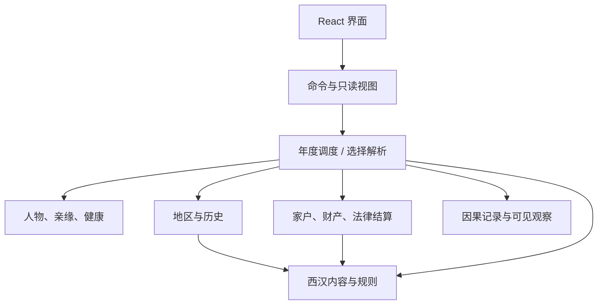

# 目标边界 · 待批准

保留 generate、confirmName、advance、decide、skip、eligible 入口。命令内完成校验和一次状态提交；跨域操作由编排器调度，底层不调用 UI、不读取全局对象。规则类型归共享契约，西汉内容实现规则，启动时由编排器选定。测试用同一命令驱动；不为未来朝代建空目录。

|领域|唯一职责与允许写入|跨域调用约定|
|---|---|---|
|core|时钟、版本、稳定顺序、调度、断言|只在命令边界提交；失败返回原状态或原有错误|
|people|身份、健康、能力、职业、实亲/婚姻、有方向的感情|人物变动产生结果；由编排器触发清算与观察|
|households / finance|在户迁移、掌家规则、户账、个人契约和遗产结算|凭据必须指明出资方、受益方与理由；亡者记录可查|
|events / simulation|筛事件、指定参与者、验证选项、定时学习/承诺与年度工作|pending 保存事件及绑定人物；失效显式取消或拒绝，不暗换角色|
|world / content|环境与事实；西汉地区、时间窗、法律、四种开局配置|引擎仅用选定规则；未来可新增重叠体系及原型，无须改账本|
|narrative / UI|有序因果、可见消息、观察和派生称谓；开发视图独立|普通界面只取已知信息；死亡结算时的历史揭示维持原时点|

拟议根状态为 meta、clock、playerId、people、households、relations、finance、world、progression、narrative。meta 包含规则、生成器/内容与快照版本、种子、分配游标。职业变更、健康与能力状态挂人物；主角专属学习进度可选，普通亲属不补齐虚构属性。movePerson 只换成员归属；成婚事务登记婚姻并调用迁居、显式置办/随迁资产；settleEstate 校验死亡，以亡者 ID 幂等处理私产与契债；对话先完成操作再从结果渲染，文本不反写事实。继承人资格和余数分配交给同版本法律规则。年度顺序见现状文档，拆函数时先做一拍一拍的等价比较。
