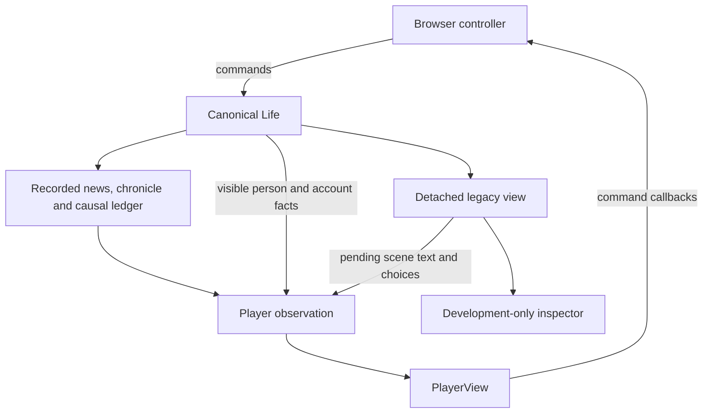
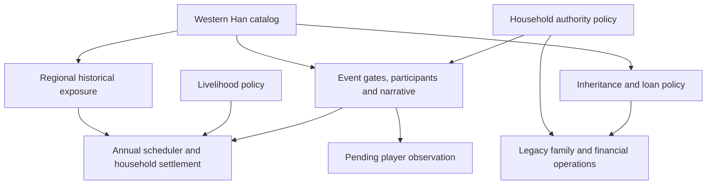

# Stage 4 — Historical content and player observations

**Review status:** implementation and local verification finished. Hosted CI acceptance is blocked. The refactor branch remains separate from main.

| Revision | Purpose |
|---|---|
| `5c99d60ddbb8a030035d1b9ad024106b95b65fe2` | Accepted Stage 3 comparison baseline |
| `3bd64e6d016897c4fbd64834275bd737dd2ea36a` | Add Engine CI first |
| `fef0aed1495e1b7c5bf63b241969d097c74ba3d1` | Separate Western Han rules, introduce the player observation and update the GDD |
| `1f7bff31f8eef76b1a231c0a09e1d6a852e326a6` | Restore the two original text separators identified by render comparison |

## CI evidence

Engine CI runs on pushes to refactor/core-architecture and on pull requests. Its read-only Ubuntu job sets up Node 22 and runs npm ci, npm test and npm run build in order. GitHub accepted the workflow and triggered it. Its first run annotation says “The job was not started because your account is locked due to a billing issue.” The implementation and corrected-code runs also concluded with failure. There is no successful hosted run to cite. Restoring the account's Actions access and obtaining a green run on the review head is an outstanding acceptance condition. [Workflow introduction](https://github.com/TheGreatCorrine/Game-FuShengLu/actions/runs/44619952781) · [Implementation run](https://github.com/TheGreatCorrine/Game-FuShengLu/actions/runs/44620713421) · [Corrected-code run](https://github.com/TheGreatCorrine/Game-FuShengLu/actions/runs/44620872054)

In an isolated directory, a clean install from the lockfile succeeded, all 57 tests in ten suites passed, and the TypeScript check, production bundle and offline HTML packaging passed. These results are local.

## State and observation boundary

Life owns stable people, kinship, marriage history, subjective relationships, each household's single account and recorded events. The annual scheduler still projects to an isolated working state after resident health and collects command results. The player observation is a fresh allowlist. Naming exposes birth details only. Ordinary play exposes current finances, qualitative health, displayed relatives, age/text journal rows and the pending scene. Only a pending scene needs the compatibility projection for normal rendering. The normal component receives the observation and commands. The development inspector is a separate sibling.

History configuration describes possible world events. Exposure records the actual regional effect, cost and hearing for a life. News records what the person heard. The ending joins recorded exposure to the historical title and source. A zero-load encounter can appear in the ending as zero local loss. Raw traits, trust scores, causal metadata, full household books and undisclosed history remain outside the player observation. The game is client-side, so the boundary governs normal presentation and cannot conceal data from someone inspecting the application in their own browser.

## Ruleset boundary

The Western Han directory owns the four household templates, locations, dated events, provisional inheritance rules, event catalog, eligibility, candidate selection, participant selection and narrative, regional hearing rules, authority and career rules. The engine retains its clock, deterministic RNG, stable IDs, account ownership, mortality and settlement mechanics. Old public imports continue to work. Event *execution*, family heuristics and some narrative side effects still read flat state. This is one implemented historical slice. A future ruleset can supply its own policies as the remaining execution paths are migrated.

## Paired regression and observation tests

Stage 3 and Stage 4 were independently bundled. For each policy, quality0 through quality599 received the same decisions. The existing comparator checks the complete canonical graph, compatibility fields, eligible choices, accounts and identity invariants after every command, plus migration round trips at age 40 and death. The Stage 3 reproduction recipe works with the baseline SHA above.

| Policy | Complete lives | Command checkpoints | Ever married in either version | Household debt at 25 / survivors in either version |
|---|---:|---:|---:|---:|
| First | 600 | 46,263 | 117 | 315 / 554 |
| Education | 600 | 46,103 | 0 | 314 / 554 |
| Conservative | 600 | 46,128 | 0 | 300 / 554 |
| Random | 600 | 46,285 | 58 | 311 / 554 |

**First simulation divergence:** none in 184,779 checkpoints. All 4,516 independent snapshot imports passed. All four golden replay outputs matched the checked-in fixture. Character-runs, cohort, debt-runs, families, household-runs, memory-pair, pair and phase2a1 each produced byte-identical output to Stage 3. These include the marriage, inheritance, ownership and memory fixtures.

Six new observation cases cover the birth allowlist, hidden-state changes and mutable nested rows, heard versus unheard regional history at ages six and seven, zero regional burden, terminal disclosure, and exact eligible choices and narrative. Existing 51 tests continue to pass.

A separate React static-markup comparison injected identical canonical snapshots into both production-mode UIs on every command in the four golden lives. Its first difference on the initial implementation was quality7 at age zero after naming. The condition paragraph had gained a full-width space before the divider, and the residence line had gained spaces around its dot. The correction restored the original display. **357 of 357 markup checkpoints then matched byte-for-byte.** This check covers rendered markup rather than browser paint timing.

## Compatibility retirement before final release

The following work is proposed for a **separately approved pre-release stabilization step**. Each row names the present execution owner and the minimum canonical replacement. Run the frozen oracle after each move. Stage 4 introduced neither a new simulation engine nor another writable representation of people or household balances.

| Sequence and responsibility | Current owner and dependency | Canonical destination and acceptance check |
|---|---|---|
| 1. Death consequences and inheritance | family.finishResidentDeaths and legal.settle use legacy keys, including for remainder ordering | Close stable marriage edges, settle each deceased person's purse and contracts once, apply the historical heir policy over parent IDs, and sort by the original ordering key. Verify same-year deaths, spouse survival, odd remainders and empty estates. |
| 2. Household settlement | economy.household and inactiveHouse enumerate flat residents and heads | Enumerate stable residents in persisted order, settle current household first, apply the same annual production/consumption to canonical accounts and close empty accounts only after obligations clear. Verify ledgers and balances on the year of death. |
| 3. Family and NPC development | family.developFamily reads legacy roles and mutates the flat roster | Register births and kin by stable IDs, assign parent edges, move membership and apply existing jobs, loans and private transfers. Preserve timing of births, new workers and RNG lookup. |
| 4. Marriage and candidates | Western Han candidate/participant selectors, scheduler candidate health, family.joinFamily and the wedding choice | Select, age and archive an external person by stable ID, create or close canonical unions and issue the original explicit endowment and move. Verify candidate exclusion, widowhood and remarriage. |
| 5. Promises and learning | encounters.fulfill and scheduler.mature use flat promises, queues and player fields | Resolve the original stable promise recipient once, apply the debt payment and memory, and mature the scheduled education entry at the same age before career and event selection. |
| 6. Event eligibility and choices | Western Han events and engine.decide / encounters.negotiate operate on a detached flat state | Feed ordered canonical facts into binding and eligibility, dispatch existing outcomes through the migrated operations, and record stable actors. Reuse the same pending scene reader for the observation. Verify each offered action, text, delta and pause. |

Finally, construct new lives directly in the canonical registry and retain old snapshot import as an explicit boundary. Remove projection/collection from ordinary advance, decide, skip, generation and observation only after the public canonical commands pass the paired oracle. Keep the external legacy API isolated for existing clients. Verify zero full conversions in those canonical entry points, rerun the late-life browser benchmark and review archive/import support before retiring the oracle.

The GDD identifies the four implemented backgrounds and provisional historical assumptions. Nine social origins, additional family structures, dynasty-specific laws, hidden aptitudes, proactive actions and markets remain future design. Research on dated applicability, identities and regional effects precedes new historical content. The paired corpus covers four policies and 600 seeds per policy. It does not exhaust possible inputs.

## Changed files

| Area | Paths |
|---|---|
| CI | `.github/workflows/ci.yml` |
| Historical content and policy | `src/content/western-han/authority.ts`, `src/content/western-han/catalog.ts`, `src/content/western-han/events.ts`, `src/content/western-han/exposure.ts`, `src/content/western-han/livelihood.ts`, `src/data.ts` |
| Engine and public API | `src/engine.ts`, `src/engine/economy.ts`, `src/engine/encounters.ts`, `src/engine/legal.ts`, `src/engine/livelihood.ts`, `src/engine/people.ts` |
| Observation, UI and tests | `src/engine/observation.ts`, `src/PlayerView.tsx`, `src/main.tsx`, `tests/observation.test.ts` |
| Design and review | `fushenglu_gdd/02_HISTORY_AND_WORLD.md`, `fushenglu_gdd/05_TECH_ARCHITECTURE.md`, `docs/architecture/README.md`, `docs/architecture/09_STAGE_4_REPORT.md` |
