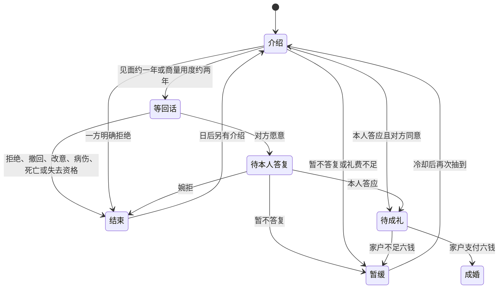

# Phase 2B.2-A · 婚议的回音

审查基线 `595e8d54cfdc7634795cf4cd0a13204d34cfa4cf`。实现 `8b4213ad6ff272f96959e6c35b6535ead2133d44`。独立分支 `feature/phase-2b2a-marriage-negotiations`。

## 玩家选择与状态



原有初婚介绍仍在 20–34 岁间与其他事件一起抽取，丧偶后的年龄上限仍为 52。约期另行登记。见面增加既有相识记忆，商量用度给两家两年时间，不会转钱。主动暂缓没有约期。婉拒只结束与眼前这个人的婚议。对方已明确表示愿意时，玩家可以答应、暂缓或拒绝；本次答复不会再掷一次同意判定。家户不足六钱时照实说明，保留原来的冷却及再遇机会。没有家庭支持可以代替当事人的同意。

每次约期以稳定人物 ID、商定年、到期年和会面方式登记；结案写明年份与原因。年度结算与史事照旧先发生。候选人使用原有健康随机流，病伤取当年实际健康结算；意愿及撤回理由使用独立的候选人、约期和会面方式随机键。到期后对方愿意才需要玩家再点一次，其他结局直接写入年谱。未入户者没有家户成员资格。已结束的人物保留最后已知状态，日后婚姻史和继承仍由原有系统处理。旧存档不补造往年的约期。

## 同种子完整人生对照

Node 24，本地运行。每行复用 `marriage-audit-0` 至 `marriage-audit-999`，共 6,000 对、12,000 次完整人生；独立种子数为 1,000。每对逐一断言首次介绍的年龄和候选人兼容键相同，包括终身没有介绍的情况。每局在死亡后检查身份、关系和家户账本。每个策略每版均有 642/1,000 人得到过介绍；首次介绍年龄四分位为 22、25、29。此指标涵盖早逝和未获介绍者，婚龄只统计实际初婚者。

| 婚议策略 | 旧→新初婚人数 / 1,000 | 旧→新终身婚姻总次数 | 新版初婚年龄 Q1 / 中位 / Q3 | 旧→新再次与同一人互动的次数 |
|---|---:|---:|---|---:|
| 直接答应 | 221→221 | 227→228 | 22 / 26 / 29 | 184→144 |
| 初见先见面，再答应 | 95→218 | 95→223 | 24 / 27 / 30 | 259→534 |
| 初见商量用度，再答应 | 95→183 | 95→184 | 24 / 27 / 30 | 259→404 |
| 介绍时从原三种行动随机选，肯定回话后答应 | 68→136 | 68→137 | 24 / 27 / 30 | 257→334 |
| 每次暂缓 | 0→0 | 0→0 | — | 277→277 |
| 每次婉拒此人 | 0→0 | 0→0 | — | 277→0 |

旧版缺少商量两年和婉拒此人，分别用“先见面”和“暂缓”作参照。其他事件一律选第一项。重复互动计数指玩家再次遇到同一候选人的可操作场景。直接答应策略保留原意愿公式与初次随机键；明确拒绝后改为下次介绍新人，因此后续配偶或再婚个数可以不同。

| 每次约期的结局 | 先见面 | 商量用度 | 混合策略 |
|---|---:|---:|---:|
| 总约期 | 777 | 784 | 297 |
| 对方愿意 | 459 | 358 | 164 |
| 明确拒绝 | 68 | 76 | 31 |
| 为家事撤回 | 64 | 73 | 24 |
| 改了谋生打算 | 63 | 80 | 31 |
| 因病伤取消 | 84 | 99 | 32 |
| 越过资格年龄 | 28 | 82 | 12 |
| 玩家去世 | 5 | 8 | 0 |
| 候选人去世 | 6 | 8 | 3 |
| 未有交代 | 0 | 0 | 0 |
| 有效约期按时得到回音 | 738/738 | 686/686 | 282/282 |
| 全部约期按时有结论，含提前终止 | 777/777 | 784/784 | 297/297 |
| 肯定回话后本次成婚 / 家户缺钱 | 218 / 241 | 182 / 176 | 76 / 88 |

有效约期只剔除双方死亡和资格过期；病伤、撤回、拒绝、改变打算全部保留在分母。按时指截止约定年份后一年底。本实现到期当年处理，死亡或超过年龄时提前结案。有效约期共 1,706/1,706，全部约期共 1,858/1,858 有明确结论。直接答应、每次暂缓和每次婉拒三个策略均未立约，及时率不适用。所有策略均未遇到崩溃或终局不变量错误。此数据只检验现有游戏规则，并非西汉婚龄或意愿分布的历史估计。

## 验证和复现

本地 `npm ci --offline`、`npm test`（14 个文件，71 项通过）、`npm run build`（TypeScript、Vite、离线 HTML）成功。新增六项针对身份、约期、旧格式导入、双方同意、拒绝再遇、资金、两方死亡、资格过期、外部人员整年收支和史料隔离的测试。现有 512 局逐次过渡审计、童年、丧偶、继承与观察边界测试通过。

把基线提交检出到另一个目录。在本分支运行以下命令，替换基线目录；JSON 输出含重复接触的人数与次数、每类约期结果、初婚与所有婚姻及现金受阻次数。

```sh
for policy in yes meet terms random pass decline; do
  node scripts/marriage-negotiation-runs.mjs ../baseline-595e8d5 "$policy"
done
node scripts/architecture-golden.mjs
```

两个版本各运行四个历史 golden 种子，冻结的 fixtures 未改写。四个完整序列的哈希均有变化，婚议文案也参与哈希。quality7、quality31 的决策轨迹相同；quality3 于 31 岁多出婚议回话；quality24 在 28 岁随扩充后的菜单从见面变为商量用度。四例死亡年龄各自仍为 75、81、65、63，婚姻总数各自仍为 1、0、0、0。童年文件与测试没有改动。

## 史料、边界与 B 阶段前提

史料记录包含场景、书名、篇卷、来源链接、时期、分类、说明及适用限制。可选分类为直接记载、历史背景或剧情演绎。首条将惠帝六年未嫁女子赋税规定用作婚议的历史背景。武帝时的角色不由此获知任何法令，游戏也不据此征税。核对文本见[《汉书》卷二《惠帝纪》六年条](https://www.donglishuzhai.net/chapter/814.html)。元数据独立存放，未接入剧情资格、NPC 记忆或 UI。

未建模完整的候选人原生家庭。撤回及改变打算是可读的剧情理由，不能据此推断一位未登记亲人的实际病情或家计。病伤在 A 中结束本次议亲。对话的真实感尚需试玩审查。直接答应时仍优先检查家户能否支付六钱，家户不足时没有接受或拒绝的推断。已给肯定回音、玩家也愿意但缺钱的情况现在可以单独观察。

B 的审查应优先看 241/459 个“先见面、双方愿意、家户仍付不起”的约定。须先明确简办时的实际支出、付款家户、亲人自愿出资与个人私款如何分别记账，再用同种子比较成婚、债务和居处变化。A 的约期与介绍规则应作该对照的基线。提前至 18–19 岁初次介绍仍待另案审查。
