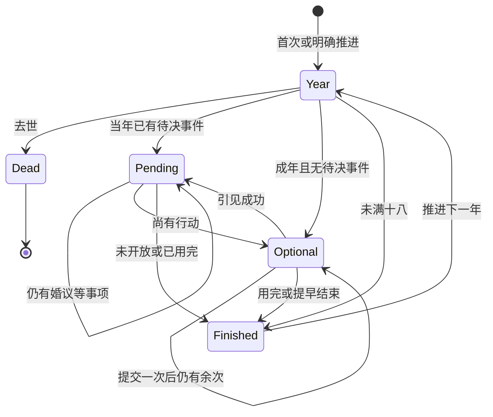

# Phase 2B.3-A · 一年里的两次主动行动

待独立审查。设计基线 01f4ffb，玩法基线 d2d5e05。18 岁是本片的成年行动门槛；婚议仍使用 Stage B 的年龄、婚姻和等候期检查。西汉普遍成年年龄不能由此推断。

## 年度调度



年度健康、家计、历史与事件均由原 runYear 结算一次。先做完待决选择，再回到原年份和余额。选择对象、看要求和取消不改状态。一次合法请求、被拒或实际赴约扣一次；已提交命令优先返回原收据。复用相同标识却更换对象、年份或行动会报错。命令校验后在副本中写入行动结果与机会；页面重送通过当前状态处理。单机命令边界不提供跨服务器同步。

额度在跨年时重新开放，余次作废。旧快进和 advance 调用可跳过主动选择；玩家界面区分等到下一次抉择、明确略过主动行动。旧快照在可确认的下一年度边界启用，不追赠当年份额。具名收据、候选人及面谈对象能随旧格式 ID 映射往返。

## 两条路径

- 同住、有能力的家户决策者可受托引见；主角当家时也可托同住父母。接受后立即进入同一位候选人的 Stage B 介绍事件，后续可以见面、暂缓或婉拒。已有对象或婚约不会叠加介绍。亲友拒绝后，同人同居处、同欠债状态的请求持续关闭。同年不能换条件重试。
- 集市雇主由同住、能出门且确有相应营生的具名家人兼任。玩家随这位熟人前往本地集市，生病、体力不足或当年承担照护时不能前往。自耕家庭的谷种机会取决于收成，佃作家庭有运租粮的活；行商经历能解锁核货，文书关系与读写经历能解锁不同差事。具名邀请有效至下一年年底；赴约占一次行动，对方去世或失去联系则中断。面谈不发工资，也不改变职业、生产或资产。稳定身份只占用原账本中的一个人。

## 完整生命对照

使用同一组 marriage-audit-0 至 999。婚议第一次遇见某人选“先见面”，以后答应，优先可负担的简礼、家人补差或常礼，否则延后。其他原有事件选第一项。引见优先按“引见、赴约、问工”，问工优先按“赴约、问工、引见”，同类选首个可见对象。跳过策略在每个可选阶段结束本年。三组分别推进至主角死亡。跳过组另跑 1,000 个 Stage B 基准生命，剔除新年度记录后做全状态深比较，包括关系、财务、决策与年谱。

| 每 1,000 生 | 全跳过 | 引见优先 | 问工优先 |
|---|---:|---:|---:|
| 曾经成婚人数 | 391 | 688 | 607 |
| 初婚年龄中位数 | 27 | 23 | 25 |
| 主角婚姻总数 | 399 | 718 | 629 |
| 子女总数 | 375 | 866 | 640 |
| 终局各户债务总额 | 143,212 | 183,639 | 168,109 |
| 可选阶段人年 | 42,915 | 42,928 | 42,914 |
| 花费次数 | 0 | 46,338 | 45,813 |
| 完成引见 | 0 | 956 | 659 |
| 亲友拒绝 | 0 | 600 | 438 |
| 面谈邀请 | 0 | 17,292 | 17,158 |
| 问工被拒 | 0 | 11,603 | 11,589 |
| 已赴约 | 0 | 15,887 | 15,969 |
| 约期届满 | 0 | 412 | 375 |
| 境况改变中断 | 0 | 993 | 814 |

### 机会和拒绝分布

分母是仍在世、成年且当年进入主动阶段的人年。可引见／可问工计第一次选择前的可用人年；结果按该年首次进入阶段时的出身、实际居处及其账本债务归组。同一人可以跨年进入不同组。各维度分别合计，不能跨维度相加。kin1 等为具体姻亲家户。花费包括赴约，引见只计已实际安排的介绍。面谈到期与中断按发出邀请时归组。

#### 全跳过

| 分组 | 人年 | 可引见 | 可问工 | 花费 | 引见 | 亲友拒 | 约谈 | 雇主拒 | 赴约 | 过期 | 中断 |
|---|---:|---:|---:|---:|---:|---:|---:|---:|---:|---:|---:|
| 出身/佃作户 | 13,750 | 2,558 | 6,761 | 0 | 0 | 0 | 0 | 0 | 0 | 0 | 0 |
| 出身/吏员之家 | 4,794 | 829 | 2,622 | 0 | 0 | 0 | 0 | 0 | 0 | 0 | 0 |
| 出身/自耕户 | 15,501 | 2,859 | 7,849 | 0 | 0 | 0 | 0 | 0 | 0 | 0 | 0 |
| 出身/行商之家 | 8,870 | 1,601 | 5,079 | 0 | 0 | 0 | 0 | 0 | 0 | 0 | 0 |
| 家债/无 | 13,600 | 3,333 | 8,367 | 0 | 0 | 0 | 0 | 0 | 0 | 0 | 0 |
| 家债/有 | 29,315 | 4,514 | 13,944 | 0 | 0 | 0 | 0 | 0 | 0 | 0 | 0 |
| 居处/birth | 32,818 | 7,758 | 16,492 | 0 | 0 | 0 | 0 | 0 | 0 | 0 | 0 |
| 居处/independent | 1,097 | 1 | 597 | 0 | 0 | 0 | 0 | 0 | 0 | 0 | 0 |
| 居处/kin1 | 9,000 | 88 | 5,222 | 0 | 0 | 0 | 0 | 0 | 0 | 0 | 0 |

#### 引见优先

| 分组 | 人年 | 可引见 | 可问工 | 花费 | 引见 | 亲友拒 | 约谈 | 雇主拒 | 赴约 | 过期 | 中断 |
|---|---:|---:|---:|---:|---:|---:|---:|---:|---:|---:|---:|
| 出身/佃作户 | 13,763 | 522 | 7,418 | 13,882 | 321 | 201 | 5,166 | 3,463 | 4,731 | 138 | 297 |
| 出身/吏员之家 | 4,772 | 175 | 2,979 | 5,597 | 108 | 67 | 2,131 | 1,364 | 1,927 | 53 | 151 |
| 出身/自耕户 | 15,526 | 574 | 8,693 | 16,034 | 331 | 243 | 5,968 | 3,978 | 5,514 | 129 | 325 |
| 出身/行商之家 | 8,867 | 285 | 5,767 | 10,825 | 196 | 89 | 4,027 | 2,798 | 3,715 | 92 | 220 |
| 家债/无 | 11,975 | 574 | 8,002 | 15,380 | 363 | 211 | 5,718 | 3,867 | 5,221 | 150 | 373 |
| 家债/有 | 30,953 | 982 | 16,855 | 30,958 | 593 | 389 | 11,574 | 7,736 | 10,666 | 262 | 620 |
| 居处/birth | 23,812 | 1,510 | 13,308 | 25,739 | 926 | 584 | 9,443 | 6,372 | 8,414 | 293 | 736 |
| 居处/independent | 1,819 | 2 | 1,070 | 1,809 | 0 | 2 | 676 | 479 | 652 | 7 | 17 |
| 居处/kin1 | 17,297 | 44 | 10,479 | 18,790 | 30 | 14 | 7,173 | 4,752 | 6,821 | 112 | 240 |

#### 问工优先

| 分组 | 人年 | 可引见 | 可问工 | 花费 | 引见 | 亲友拒 | 约谈 | 雇主拒 | 赴约 | 过期 | 中断 |
|---|---:|---:|---:|---:|---:|---:|---:|---:|---:|---:|---:|
| 出身/佃作户 | 13,750 | 1,214 | 7,280 | 13,639 | 214 | 159 | 5,103 | 3,430 | 4,733 | 113 | 257 |
| 出身/吏员之家 | 4,777 | 430 | 3,012 | 5,723 | 78 | 29 | 2,178 | 1,440 | 1,998 | 62 | 118 |
| 出身/自耕户 | 15,523 | 1,434 | 8,527 | 15,860 | 245 | 193 | 5,883 | 4,006 | 5,533 | 115 | 235 |
| 出身/行商之家 | 8,864 | 950 | 5,589 | 10,591 | 122 | 57 | 3,994 | 2,713 | 3,705 | 85 | 204 |
| 家债/无 | 12,998 | 1,995 | 8,665 | 16,871 | 233 | 139 | 6,331 | 4,287 | 5,881 | 158 | 318 |
| 家债/有 | 29,916 | 2,033 | 15,743 | 28,942 | 426 | 299 | 10,827 | 7,302 | 10,088 | 217 | 496 |
| 居处/birth | 26,921 | 3,991 | 14,948 | 29,096 | 640 | 423 | 10,806 | 7,320 | 9,907 | 298 | 601 |
| 居处/independent | 1,421 | 1 | 771 | 1,321 | 0 | 1 | 494 | 350 | 476 | 3 | 15 |
| 居处/kin1 | 14,572 | 36 | 8,689 | 15,396 | 19 | 14 | 5,858 | 3,919 | 5,586 | 74 | 198 |

## 试玩与复现

在开发版的“开发者调试”输入完整种子，姓名填宁。依上文策略选择；年龄为邀约当时或请求当时的年龄。

| 种子 | 策略及观察点 |
|---|---|
| marriage-audit-0 | 引见优先。18 岁可问郑安整理布匹的活，当年第二次行动即可赴约。19 岁问同类工作会得知人手已满。 |
| marriage-audit-1 | 引见优先。20 岁托郑成引见许素，接着仍由双方决定是否成婚。 |
| marriage-audit-2 | 引见优先。20 岁得到整理布匹的邀约，在此策略下最终过期。 |
| marriage-audit-3 | 引见优先。27 岁取得的整理布匹面谈在境况变化后中断。 |

本地 Node 24。以 Stage B 提交作相邻工作树，从本分支运行：

```sh
git worktree add --detach ../stage-b d2d5e05a1c056858ad05b1d95fff3405d482aa34
npm test
npm run build
for policy in skip family market; do
  node scripts/annual-action-runs.mjs ../stage-b "$policy"
done
```

86 项本地测试（16 个文件）通过。TypeScript、Vite 和离线 HTML 构建通过。自动化完整生命统计使用真实 advance/decide/主动命令；每次主动操作检查所有家庭账本、个人钱财和贷款。工作区的 Chromium 启动器缺少浏览器可执行文件，本次没有完成浏览器点击验收。

## 独立审查重点

引见优先使初婚更早，也产生更多子女；它改变了主动接触次数。监测长期策略效果时应同时看能接触谁、拒绝、闲置次数和债务。问工仍只覆盖同住关系能引到的集市；没有合适熟人的年份会出现空选项。访谈不带收入，不能用本片推断带薪工作会否抹平出身差异。到期与中断分别留痕，工作机会不会自动转成工作。较高终局债务单列给原经济调查，本片没有调整经济或婚姻概率。

下一次玩法讨论建议先看无合适熟人的玩家能否通过已有工作或习读结识一位具体联系人，再决定是否增加非亲属雇主。工资进入游戏前必须核定付款户、期限、替代工时及收入归属。
